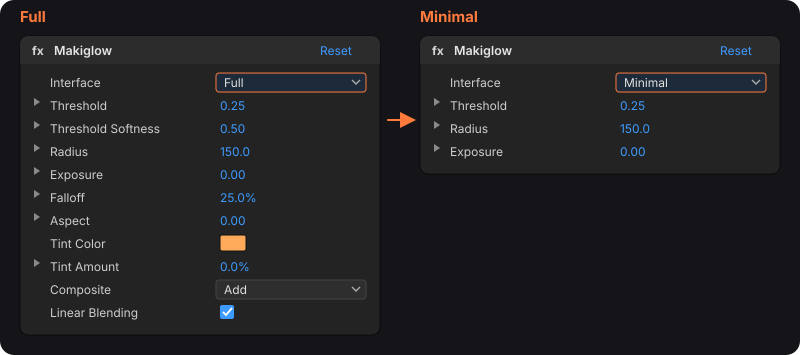

<p align="center"></p>

<p align="center">
  <a href="https://github.com/Moliiknis/Makiglow/releases/latest"></a>
  
  
  <a href="LICENSE.md"></a>
</p>

<p align="center"><b>English</b> · <a href="#русский">Русский</a></p>

<p align="center"><a href="https://github.com/Moliiknis/Makiglow/releases/latest"><b>⬇ Download Makiglow-1.1.0-Setup.exe</b></a></p>

## English

A glow that behaves like real light: many layers of soft bloom that fall off naturally, computed in linear color.

Similar to **Deep Glow**. Written from scratch: not affiliated with its authors and contains none of their code.

<table>
<tr><td width="33%" valign="top"><b>Natural falloff</b><br><sub>Radius up to 4000 px with exposure and falloff controls.</sub></td><td width="33%" valign="top"><b>Pick what glows</b><br><sub>Threshold with softness decides which highlights bloom.</sub></td><td width="33%" valign="top"><b>Tint</b><br><sub>Color the glow without touching the source.</sub></td></tr>
<tr><td width="33%" valign="top"><b>Aspect</b><br><sub>Stretch the glow horizontally or vertically for anamorphic looks.</sub></td><td width="33%" valign="top"><b>Composite modes</b><br><sub>Add, Screen or Glow Only for separate passes.</sub></td><td width="33%" valign="top"><b>Fast and deep</b><br><sub>8/16/32 bpc, linear blending, multi-frame rendering.</sub></td></tr>
</table>

### Two interfaces

Choose how much interface you see. Two presets come built in, **Classic** (everything in view) and **Minimal** (only the essentials), and you can build your own: which parts to show, density and accent color.

- **Effect Controls:** the first parameter, **Interface**, switches between `Full` and `Minimal`. Minimal keeps only the key controls; hidden values are kept and still work.

<p align="center"></p>

### Install

1. Download **`Makiglow-1.1.0-Setup.exe`** from [Releases](https://github.com/Moliiknis/Makiglow/releases/latest).
2. Close After Effects and run the installer. It asks for administrator rights because the effect goes into the After Effects folder.
3. Start After Effects and open **Effect › Makimchi › Makiglow**.

> **SmartScreen?** The installer is not code-signed yet. Click *More info* → *Run anyway*.

<sub>After Effects 2022 or newer · Windows 10/11 x64 · Uninstall from *Settings → Apps → Makiglow for After Effects*</sub>

<details>
<summary><b>Build from source</b></summary>

Needs Visual Studio 2022+ with *Desktop development with C++* and the [After Effects SDK](https://developer.adobe.com/after-effects/). The SDK is looked up in `%USERPROFILE%\Downloads\AfterEffectsSDK_27.0.0_win\AfterEffectsSDK\Examples`; set `AESDK` to use another folder.

```powershell
.\build-installer.ps1   # builds the plug-in and release\Makiglow-1.1.0-Setup.exe
```


</details>

### The Makimchi set

| Plug-in | What it does |
|---|---|
| **Makiglow** | Soft, natural glow for After Effects |
| [Makimood](https://github.com/Moliiknis/Makimood) | Cinematic color grading with a live looks window |
| [Makiblur](https://github.com/Moliiknis/Makiblur) | Motion blur from the footage's own motion |
| [Makitor](https://github.com/Moliiknis/Makitor) | Smooth slow motion and speed ramps on the timeline |
| [Makiease](https://github.com/Moliiknis/Makiease) | Keyframe easing, one click away |
| [Makifind](https://github.com/Moliiknis/Makifind) | Find and apply any effect in two keystrokes |

### License

[PolyForm Noncommercial 1.0.0](LICENSE.md): free for personal and any noncommercial use; you may change it and share it. Commercial use (selling it, paid client work, use in a company for profit) is not allowed.

<br>

---

## Русский

Свечение, которое ведёт себя как настоящий свет: много слоёв мягкого ореола с естественным затуханием, расчёт в линейном цвете.

Аналог **Deep Glow**. Написан с нуля: не связан с авторами оригинала и не содержит их кода.

<table>
<tr><td width="33%" valign="top"><b>Естественное затухание</b><br><sub>Радиус до 4000 px, экспозиция и затухание.</sub></td><td width="33%" valign="top"><b>Что светится</b><br><sub>Порог с мягкостью выбирает, какие света дают ореол.</sub></td><td width="33%" valign="top"><b>Оттенок</b><br><sub>Окрашивает свечение, не трогая исходник.</sub></td></tr>
<tr><td width="33%" valign="top"><b>Аспект</b><br><sub>Растягивает свечение по горизонтали или вертикали, как анаморф.</sub></td><td width="33%" valign="top"><b>Режимы наложения</b><br><sub>Add, Screen или Glow Only для отдельного прохода.</sub></td><td width="33%" valign="top"><b>Быстро и глубоко</b><br><sub>8/16/32 bpc, линейное смешивание, многопоточный рендер.</sub></td></tr>
</table>

### Два интерфейса

Можно выбрать, сколько интерфейса видно. Есть два готовых пресета: **Classic** (всё на виду) и **Minimal** (только главное). Можно и собрать свой вариант: какие части показывать, плотность и цвет акцента.

- **В Effect Controls** первый параметр **Interface**: `Full` или `Minimal`. В Minimal остаются только главные ползунки, остальные значения сохраняются и работают.

### Установка

1. Нужно скачать **`Makiglow-1.1.0-Setup.exe`** со страницы [Releases](https://github.com/Moliiknis/Makiglow/releases/latest).
2. Нужно закрыть After Effects и запустить установщик. Он запросит права администратора, потому что эффект ставится в папку After Effects.
3. Нужно открыть After Effects: **Эффект › Makimchi › Makiglow**.

> **SmartScreen?** Установщик пока не подписан сертификатом. Нужно нажать *Подробнее* → *Выполнить в любом случае*.

<sub>After Effects 2022 и новее · Windows 10/11 x64 · Удаление: *Параметры → Приложения → Makiglow for After Effects*</sub>

<details>
<summary><b>Сборка из исходников</b></summary>

Нужны Visual Studio 2022+ с *Desktop development with C++* и [After Effects SDK](https://developer.adobe.com/after-effects/). SDK ищется в `%USERPROFILE%\Downloads\AfterEffectsSDK_27.0.0_win\AfterEffectsSDK\Examples`, другую папку нужно указать в переменной `AESDK`.

```powershell
.\build-installer.ps1   # собирает плагин и release\Makiglow-1.1.0-Setup.exe
```


</details>

### Набор Makimchi

| Плагин | Что делает |
|---|---|
| **Makiglow** | Мягкое естественное свечение для After Effects |
| [Makimood](https://github.com/Moliiknis/Makimood) | Кинематографичная цветокоррекция с живым окном луков |
| [Makiblur](https://github.com/Moliiknis/Makiblur) | Motion blur из собственного движения футажа |
| [Makitor](https://github.com/Moliiknis/Makitor) | Плавный слоумо и рампы скорости прямо на таймлайне |
| [Makiease](https://github.com/Moliiknis/Makiease) | Плавность ключей в один клик |
| [Makifind](https://github.com/Moliiknis/Makifind) | Любой эффект за два нажатия |

### Лицензия

[PolyForm Noncommercial 1.0.0](LICENSE.md): бесплатно для личного и любого некоммерческого использования, можно изменять и делиться. Коммерческое использование (продажа, платные заказы, использование в компании ради прибыли) не разрешено.

<p align="center"><sub>Made with care · <b>Makimchi</b></sub></p>
